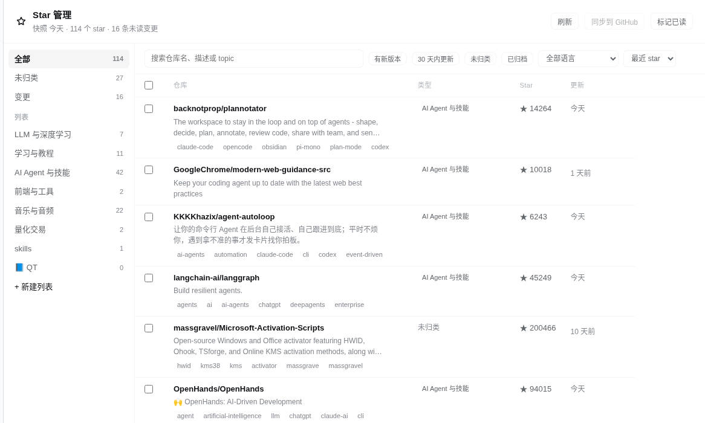
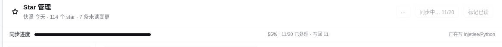
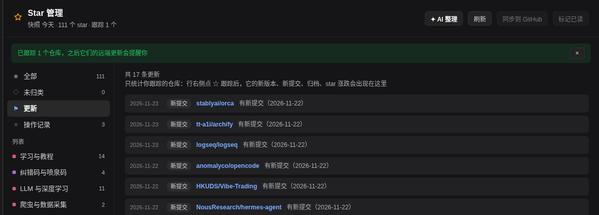
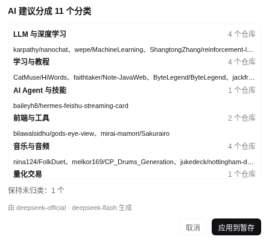

# dsh-stars

DSH 里的 GitHub Star 管理器：把 star 归进 GitHub Lists，并在面板里看到「自上次查看后有什么变了」。

## 它解决什么

GitHub 自带的 stars 页面只能一页页翻，分类要么靠 Lists（没有批量归类），要么靠记忆；官方也不告诉你哪些收藏的仓库发了新版本、哪些归档了。

主要功能如下。

1. **看类型**：按关键词把 star 分成六类（AI Agent 与技能、LLM 与深度学习、前端与工具、学习与教程、音乐与音频、量化交易），并给每个未归类的仓库一条归类建议。建议只是建议，不会自动写。
2. **分类查看**：左侧按「全部 / 未归类 / 每个 Lists / 操作记录 / 更新」切换；列表分页（每页 30/50/100/200，底部翻页，选择可以跨页）；四维排序（最近 star / 最近更新 / star 数 / 名字，点表头即切）、chip 筛选（有新版本 / 30 天内更新 / 未归类 / 已归档）+ 语言筛选 + 搜索、多选与 Shift 区间（点一行的任意位置就能勾选）；类型分布条上的「采纳全部建议」一次把建议批量暂存，再点一次同步写回。
3. **AI 整理**：点右上角「✦ AI 整理」，让宿主里配好的模型按描述和 topics 给出一套分类方案。已经有分类时会先问你：**基于当前分类整理**（只动未归类的，新建分类至少要有 2 个仓库）还是**完全重新整理**（按模型的判断重排所有 star）。模型只出方案，面板把方案写进暂存，仍然要你看预览再同步。插件建的分类会带一句描述 `dsh-stars 自动创建`，在 GitHub 的 Lists 页里能一眼认出来。
4. **结构操作**支持取消 star、删除分类和清理孤儿成员。删除分类时可以只移出这个分类，也可以把成员移入另一个分类。

5. **跟踪变更**：每次抓取和上一次快照比对，产出新收藏、新版本、新提交、归档、Star 涨跌、取消收藏六种变更，并记「未读数」；Star 涨跌只有超过 10 个或 10% 才登记，避免 +1 噪声。
6. **保存视图**会记住当前列表、关键词、语言、筛选和排序。例如选中 TypeScript 和「有新版本」，点「保存视图」，下次就能从左栏打开最近 30 天发布过版本的 TypeScript 仓库。视图按 GitHub 账号保存在 DSH 宿主，同一宿主的不同浏览器可以共用。
7. **仓库详情**在仓库名旁边。可以查看收藏时间、当前分类、暂存的增删和关键词建议的依据。点「查看发布说明」才会读取该版本的正文。

分类保存在 **GitHub Lists**。面板先暂存改动，点「同步到 GitHub」可以核对账号和每个仓库的原分类、目标分类。超过 50 条可以继续展开，任何一条都可以撤销。确认时宿主重新读取远端归属。如果你在 GitHub 网页给同一仓库加了另一个分类，面板会把它保留在新预览里，等你再次确认。窄屏下分类导航横向滚动，跟踪和取消 star 按钮直接显示在仓库行内。



同步时顶部有进度条（百分比、已处理/总数、写回与失败数、当前仓库），写回在宿主后台按 `syncConcurrency` 并发跑，每写一条落盘：



左栏有两本账，不要混在一起：

- **`⚑ 更新`**：远端仓库的变化（新版本、新提交、归档、star 涨跌）。**只统计你跟踪的仓库**——默认一个都不跟踪，所以默认没有未读。在列表里点行右侧的 `☆ 跟踪`（或选中多个后点「跟踪」）就开始跟踪；顶部 `N 条未读` 只算这里的，点它会跳到更新页。「标记已读」只清未读，不动 GitHub。
- **`≡ 操作记录`**：你自己在这个面板里做过的事——收藏、取消收藏、归类、同步写回、建/删分类、AI 整理。没有未读概念，纯粹是操作留痕。



AI 整理给出的方案（模型只出建议，还要你点「应用到暂存」再同步）：



## 安装

在 DSH 的插件市场里搜 `dsh-stars` 直接点击安装（市场从 GitHub Release 上的预构建包装，不需要构建）。等价的命令行：

```bash
dsh plugin --profile web add https://github.com/whiplashf/dsh-stars/releases/latest/download/dsh-stars.tgz
```

`latest/download` 指向最新的 Release，所以这个地址不用随版本变化。

本地开发时直接装目录（profile 里写入 `link:` 依赖，改客户端代码刷新即可）：

```bash
dsh plugin --profile web add link:/path/to/dsh-stars
```

装完刷新页面，左侧栏出现「Star 管理」入口。

### 第一次使用

面板所有数据都通过 `gh` CLI 拿，所以需要：

1. 装好 [GitHub CLI](https://cli.github.com/)（`gh --version` 能跑）。
2. `gh auth login` 登录。
3. 写回 Lists 需要 token 带 `user` scope：

   ```bash
   gh auth refresh -h github.com -s user
   ```

没登录或缺 scope 时，面板顶部会显示一张检查卡，写明缺什么、给出可直接复制的命令，点「重新检查」重新探测。缺 `user` scope 时，可以浏览、对已有分类暂存、查看预览和撤销。补上权限后即可确认写回。

刷新数据靠 `gh` 的 API 调用，star 很多时首次抓取需要几十秒（GitHub 的 Lists 归属要按列表分页拉）。

## 数据与接口

- 状态文件：`$DSH_HOME/data/dsh-stars/state.json`（默认 `~/.dsh/data/dsh-stars/state.json`），可用 `config.stateFile` 覆盖。文件按 GitHub 登录账号保存快照、暂存、跟踪与记录。切换 gh 账号后点「刷新」，切回原账号可以接着整理。
- 面板只和 `POST /api/dsh-stars` 通信，走 `ctx.connection.fetch`（Owner Peer + Host/Origin 栅栏），浏览器拿不到 GitHub token。
- action：`state` / `refresh` / `stage` / `acceptSuggestions` / `plan` / `discardPending` / `sync` / `progress` / `createList` / `unstar` / `deleteList` / `removeOrphan` / `organize` / `organizeApply` / `watch` / `markViewed` / `checkAuth`。
- `plan` 返回 `viewer`、`plan`、`summary` 和 `planVersion`。撤销某条暂存时，发送 `{ action: "discardPending", viewer, planVersion, fullName }`。响应里的 `preview` 是撤销后的新预览。
- `sync` 先读取完整分类目录和待写仓库的收藏状态，核对通过后启动后台任务并返回 job。面板用 `progress` 轮询，每条成功写回的记录都会落盘。若远端改动影响计划，接口返回 409 和 `reason: "remote-lists"`，再次读取 `plan` 即可看到合并结果。
- 按预览写回时发送 `{ action: "sync", viewer, planVersion, expectCount }`。账号、仓库或分类内容变化会返回 409。原来只传 `expectCount` 的调用方需要一并回传预览的 `planVersion`。直接调用 `sync` 仍可同步当前账号的整条队列。
- `unstar` / `deleteList` 同样是后台作业（`job.kind` 分别是 `unstar` / `deleteList`）；`removeOrphan` 是单条即时操作。
- `state.savedViews` 返回当前账号的已存视图。新建用 `saveView`，传入 `viewer`、`name`、`filters`。更新时附上视图的 `id` 和 `revision`，删除用 `deleteView` 并回传同一组标识。另一页面已修改该视图时返回 409。
- `releaseNotes` 接受 `viewer`、`fullName` 和快照里的 `tag`，按需返回版本名称、正文和 GitHub 链接。
- `organize` 只调模型出方案（`{ mode: 'reuse'|'rebuild', scope: 'unsorted'|'all' }` → 分组 + 未归类），不碰 GitHub；`organizeApply` 把方案按名字映射成 Lists（缺的会新建）写进暂存，之后仍走「同步到 GitHub」。
- 写操作启动时重新核对 gh 登录账号。独立子进程通过 `gh auth token --user` 取得指定账号的授权，仅用于该次 gh API 调用。宿主状态、日志和浏览器中均不保存凭据。

## 配置

| 键 | 默认 | 说明 |
| --- | --- | --- |
| `stateFile` | `$DSH_HOME/data/dsh-stars/state.json` | 状态文件路径 |
| `minRefreshMs` | `600000` | 打开面板时快照超过这个时长才重新抓取 |
| `staleDays` | `365` | 超过多少天没有 push 标为「一年未更新」 |
| `suggestRules` | 内置六类 | 整表替换归类规则，每项 `{ name, keywords }`；关键词命中 topics、描述或仓库名 |
| `syncConcurrency` | `4` | 同步写回的并发数（1–8） |
| `organizeProvider` / `organizeModel` | 不填 | 「AI 整理」用哪个模型；不填就用宿主里第一个可用的提供商与模型 |

## 已知边界

- 首次抓取只建基线，不会把几百个仓库都报成「新收藏」。
- GitHub 按整组分类写回。插件以同步前读到的最新归属为基础，只重放本地实际增删的分类。如果在这次核对完成后、该仓库实际写入前又从别处修改它，仍可能出现覆盖。[GitHub Lists 接口](https://docs.github.com/en/graphql/reference/users#updateuserlistsforitem)
- 取消 star 会同时把仓库移出所有 Lists（GitHub 的行为），本地记录里会留下一条 `unstarred` 变更；如果别的设备取消的 star，则记作 `gone`。
- 删分类前会重新取一次远端成员（本地快照可能落后），成员搬完才删；中途失败就停在「分类还在、部分成员已搬走」的状态，重试即可继续。
- 变更追踪的粒度是仓库级（release tag、pushedAt、archived、star 数），不是逐 commit 或逐文件。
- 建议归类是关键词规则，不是模型；误判就在面板里改，规则可通过 `suggestRules` 调。没命中任何关键词的仓库会留在「未归类」，这时用「AI 整理」或手工处理。
- 分页只发生在面板里，`state` 仍是一次返回整份快照（这样筛选、计数、跨页选择都不用二次请求）；抓取的硬上限是 10000 个 star（100 页 × 100），超过的部分不会加载。
- 「AI 整理」的结论取决于宿主里配的模型，同一批 star 两次跑可能给出不同分组；它只写暂存，写回 GitHub 前仍要过预览确认。基于当前分类整理时，只有 1 个仓库的新主题会留在未归类。完全重整时，模型漏答和失败批次中的仓库保留原归属。「重试失败仓库」只重发失败批次，已成功的结果可以单独应用。
- 分类目录和成员都按 GitHub 的游标翻页。分页缺失或数量对不上时会中止预检并保留暂存。

## 结构

```
index.js          宿主半边：注册 POST /api/dsh-stars，串起抓取/暂存/同步
src/github.js     调 gh CLI 读 Lists/star、写 Lists（GraphQL，不碰 token）
src/store.js      本地快照 + 变更 diff + 待同步暂存 + 同步计划
src/saved-views.js  账号内的筛选视图与并发编辑校验
src/classify.js   归类规则（关键词命中 topics/描述/仓库名）
src/organize.js   AI 整理：拼 prompt、解析模型 JSON、按现有分类收敛
client.js         浏览器半边：左栏图标 + 整页面板
tests/            node:test 单测与宿主接口回归测试，使用临时状态和模拟服务
scripts/          验证脚本：smoke.mjs（只读冒烟）、roundtrip.py（真实写回往返）
docs/             截图、设计细节（DETAIL.md）、v0.2 设计（DESIGN-v0.2.md）、ADR、交接笔记（HANDOFF.md）
```

## 开发

```bash
npm run check   # 语法检查
npm test        # node:test 单测
```

真实往返脚本使用环境变量 `DSH_BASE`、`DSH_COOKIE`（会话文件路径）和 `DSH_RT_REPO`（探针仓库）。自签名 HTTPS 可用 `DSH_CA_FILE` 指定 CA。脚本先检查队列为空，每次只同步探针的预期改动，结束时清理本次创建的临时列表。

- 只验证过 DSH `0.2.2-rc.3`（`package.json` 的 `engines.dsh` 钉了这个范围）。
- 改宿主代码（`index.js`、`src/`）后，用 `plugin_manager` 把 `include:dsh-stars` 关一次再开一次即可热重载，不要重启 `dsh-web`。
- 改 `client.js` 后刷新页面即可。

## 许可

MIT
