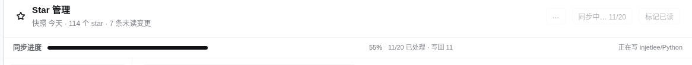

# Star 管理

DSH 左侧栏的面板：把 GitHub star 归进 Lists，并告诉你自上次查看后有哪些仓库发了新版、有了新提交、被归档或加了 star。

## 1. 类型与分类

- 左侧「列表」分成两条路：**未归类**（没有进任何 Lists 的）+ 你已有的 Lists。面板不发明分类体系，分类结果直接落在 GitHub Lists 上，网页和手机端看到的一致。
- 内置六条归类建议：AI Agent 与技能、音乐与音频、LLM 与深度学习、量化交易、学习与教程、前端与工具。建议来自仓库的 topics、描述和仓库名，**只给建议**，点一下才暂存。
- 采纳建议时如果对应名字的 Lists 还不存在，会先创建再暂存（创建是真实的 GitHub 操作，暂存不是）。
- 分布条右侧的「采纳全部建议 (n)」批量做同样的事：只给「还没归任何列表」的仓库暂存建议，已归类的跳过；写回 GitHub 仍然要用户再点一次「同步到 GitHub」。

## 2. 归类是两段式的

页面上的「归入列表」和「移出列表」只改本地 `pending`，顶部「同步到 GitHub (n)」才真正写回。点同步后：

- **先出预览**：宿主返回待写回的 `plan`（每条仓库从哪些分类到哪些分类）和按分类汇总的条数，确认按钮写「写回 N 个仓库」。写回是不可见的批量操作，先让人看见要动多少、动到哪。
- 确认时带 `expectCount`：如果这期间队列变了（比如另一台设备改了归属），宿主动手前先返回 409 让你重看预览，不会照着过期的清单写。
- 写回在宿主后台跑（`syncConcurrency`，默认 4 并发），接口立刻返回 job，面板每 350ms 轮询 `progress`，顶部出现进度条（百分比 + 已处理/总数 + 已写回/失败 + 当前仓库）；
- 每写回一条就 `save()` 一次，所以断网、刷新页面、甚至重启插件都不会丢已完成的部分；重新打开面板时会接着显示未跑完的进度；
- 同步期间禁用「刷新」「标记已读」和批量归类（宿主会拒绝 `stage`/`acceptSuggestions`），避免抓回来的旧 Lists 归属把状态抖回去。
- 进度条长这样：

  

好处是：

- 批量改十几条不产生十几次请求，也不会改到一半断网留下半成品；
- 同步失败时本地改动还在，重试即可；
- 写回用的是完整归属列表（替换语义），不会把同一个仓库放到重复的 Lists。

## 3. 排序、筛选与多选

- **排序**：最近 star、最近更新、star 数、名字四维，点表头就在升降序之间切；选择记在 `localStorage['dsh-stars.sort']`，下次打开还是上次那样。默认「最近 star 倒序」。
- 排序完全在浏览器里做：GitHub 的 `viewer.starredRepositories` 只支持按 `STARRED_AT` 排序（`StarOrderField` 只有这一个值），按 star 数或推送时间排必须客户端算。
- **筛选**：四个 chip（有新版本 = 最近 30 天发过 release、30 天内更新、未归类、已归档）+ 语言下拉 + 搜索框，全部叠加生效。语义是「只看已经 star 的」，不会把别的仓库变出来。
- **多选**：勾选框支持 Shift 点选区间，点一行的任意位置也能勾上（点到按钮、链接、输入框或正在选文字时不触发）；「全选」选的是**当前筛选结果**（按钮上带数字），不是全部 star。
- 切分类、改搜索、改筛选、改语言时会清空选区——避免「看着三行、实际选了两百个」。
- 语言列表按当前仓库集动态生成，不做枚举。

## 4. 首次运行：先检查 gh

面板所有数据都走 `gh` CLI，所以打开面板时宿主先跑一次 `gh auth status --json hosts`（结果缓存 30 秒），把三种常见卡点变成一张卡而不是一句看不懂的报错：

| 状态 | 面板表现 |
| --- | --- |
| 找不到 `gh`（`ENOENT`） | 卡片提示装 GitHub CLI，给官网链接 |
| 未登录（`gh auth status` 报未认证） | 卡片给 `gh auth login`，附复制按钮 |
| 已登录但 token 缺 `user` scope | 卡片给 `gh auth refresh -h github.com -s user`；**浏览/建议/暂存照常可用**，只有「同步到 GitHub」被禁用 |

卡片在标题下方，带「复制」和「重新检查」（`checkAuth`，强制重新探测；探测通过后顺手抓一次数据）。缺 `gh` 或未登录时宿主不会再去发注定失败的抓取请求，直接渲染已有快照。

## 5. 结构操作：取消 star / 删除分类 / 孤儿

这三件事改的是「仓库本身」和「分类本身」，不是归属，所以**不进暂存队列**，直接作为后台作业执行（`job.kind` 分别是 `unstar` / `deleteList`），进度条和同步共用一套：

| 操作 | 入口 | 行为 |
| --- | --- | --- |
| 取消 star | 行内「取消 star」或选中后批量 | 二次确认后 `removeStar`；GitHub 会同时把它从所有 Lists 移出，本地立即移除并记一条 `unstarred` 变更 |
| 删除分类 | 分类页右侧「删除分类」 | 先选成员去向：**变未归类**（默认）或**移入另一个分类**；逐条 `updateUserListsForItem` 搬完、全部成功后才 `deleteUserList`，失败就停在「分类还在」的状态，重试继续 |
| 移出孤儿 | 分类页底部折叠区 | 孤儿 = 挂在分类里但已经不在 star 里的仓库（GitHub API 允许这种状态）。逐个「移出」即时生效，不用确认 |

几个实现上的取舍：

- 删分类前会**重新取一次远端成员**，不信本地快照：本地可能落后（比如刚在网页上往分类里加过仓库），按旧快照当「空分类」直接删会把成员变成孤儿。
- `deleteUserList` 不清除成员的归属记录，删完再刷新，仓库仍带着已删除的 list id；所以顺序必须是「先搬人、后删列表」，且删完由本地 `removeList` 把这个 id 从所有仓库的归属里摘掉。
- 取消 star 是仓库消失，不是归属变化；如果仓库是被别的设备取消的 star，变更记 `gone` 而不是 `unstarred`——区分「我点的」和「别处发生的」。
- 孤儿成员不参与 `desiredLists` 的计算，只在所属分类下显示成灰色行，不会混进正常仓库列表。

## 6. 快照比对

每次抓取（打开面板超过 `minRefreshMs` 或手动点刷新）都会和上一次快照比对，产出两类记录：

| 事件 | 去向 | 判定 |
| --- | --- | --- |
| 新收藏 | 操作记录 | 快照里新出现的仓库（首次抓取不产生） |
| 取消收藏 | 操作记录 | 上次有、这次没了；本机点「取消 star」的记 `unstarred`，别处取消的记 `gone` |
| 新版本 | 更新（仅跟踪仓库） | `latestRelease.tagName` 变了，或从无到有 |
| 新提交 | 更新（仅跟踪仓库） | `pushedAt` 变新且没有新版本 |
| 归档 | 更新（仅跟踪仓库） | `isArchived` 从 false 变 true |
| Star 变化 | 更新（仅跟踪仓库） | `stargazerCount` 有增减，记录增量 |

Star 数每天小幅波动很正常，只有涨跌超过 `STAR_DELTA_MIN`（10 个）或该仓库 star 数的 10% 才登记，避免淹没真正的代码变更。两类记录各最多 400 条；同一仓库的同一种事件只留最新一条。

## 7. 两本账：操作记录 vs 更新

| | 操作记录（左栏 `≡`） | 更新（左栏 `⚑`） |
| --- | --- | --- |
| 内容 | 用户在这个面板里做的事：收藏/取消收藏、归类、移出、同步、建删分类、AI 整理 | 远端仓库的变化：新版本、新提交、归档、star 涨跌 |
| 来源 | `store.pushOp()` 在动作成功后立刻写 | `applyFetch()` 比对前后快照生成 |
| 过滤 | 无 | 只记 `state.watched` 里的仓库；默认空 = 不跟踪 |
| 未读 | 没有该概念 | `updatesViewedAt` 之后产生的条目 |

- `state.version` 升到 2；`load()` 见到 v1 会把旧的 `changes` 按 kind 拆进 `ops` / `updates`，并把 `watched` 清空、所有历史更新标记已读（语义变了，旧的未读数没有意义），随后立刻落盘，避免下次启动又「升级」一次。
- 跟踪开关走 `{action:'watch', fullNames, watch}`：单行点 `☆`、多选点「跟踪」；顶部显示「跟踪 N 个」。
- 未读只来自 `updates`：`markViewed()` 只写 `updatesViewedAt`，不影响操作记录。

## 8. AI 整理

- 入口是右上角的「✦ AI 整理」。已经有分类时先问一句：**基于当前分类整理**（`mode: reuse`，只动未归类的仓库）还是**完全重新整理**（`mode: rebuild`，所有 star 重排）；一个分类都没有就直接按全部 star 出方案。
- 模型来自宿主本身：`ctx.get('llm')` → `listProviders()` / `listModels()`，`prepareCall({ provider, model, maxTokens })` 拿到流，再按 `text-delta` 累积成一段文本。可以用 `organizeProvider` / `organizeModel` 钉死路由，不填就用第一个能报出模型的提供商。
- prompt 是「一行一个仓库」（`序号|仓库|描述|topics|语言|star`）+ 现有分类清单，要求模型只回 `{"groups":[{"list":"分类名","repos":[...]}],"unsorted":[...]}`。超过 60 个仓库分批调用，同名分类跨批合并。
- 解析不信任模型：`extractJson` 容忍代码块与尾逗号；`normalizePlan` 丢掉不存在的仓库名、去重、复用现有分类名的大小写、截断超长名、最多 12 个分类。reuse 模式下**新建分类至少要有 2 个仓库**，否则回未归类——避免模型给每个仓库单开一个分类。
- 模型只出方案：结果对话框显示分组、新建标记、保持未归类的数量与「由哪个模型生成」，点「应用到暂存」才写进 `stage`，之后仍要过预览 + 同步。一次调用实测 9–20 秒（26 个仓库、`deepseek-flash`），所以对话框里带进度文案。
- 扩展名/依赖都没有：不 `import '@deepseek-ai/dsh-llm'`，因为插件装在 `link:` 目录里解析不到 DSH 的 node_modules。

## 9. 统计口径

- 顶部显示快照时间、star 总数、跟踪数量、未读更新数；
- 底部一行：star 数、Lists 数、未归类数、上次查看时间、GitHub 列表页入口；
- 分类页底部的孤儿数是分类成员数的一部分（与 GitHub 一致），但那些仓库不在 star 列表里，所以「分类计数之和 + 未归类」可能大于 star 总数；
- 「只看一年未更新」用 `pushedAt` 判定，阈值是 `config.staleDays`（默认 365）。

## 10. 边界与取舍

- 面板不写 GitHub token，也不直连 GitHub：所有请求走宿主的 `/api/dsh-stars`，宿主用已登录的 `gh` CLI。
- 子进程环境做过裁剪（只留 `PATH`/`HOME`/`LANG`/`LOCALE`/`TZ`/`TERM`/`GH_*`，剔除含 `TOKEN`/`SECRET`/`PASSWORD`/`CREDENTIAL` 的变量），防止把 profile 里的密钥漏给 `gh`。
- 抓取有 10 分钟节流、单飞锁（连续点刷新只发一次请求）、40 秒超时和 32MB 输出上限。
- 同一时刻只允许一个后台作业（同步 / 取消 star / 删分类共用），避免两条写路径互相覆盖。
- `lists(first: 30)` 是 GitHub 的上限；正好 30 个时归属信息可能不全，代码会回退用上一次的归属。
- 面板只显示仓库级变化，做不到「这个仓库上次提交改了哪些文件」；那需要 clone 或 diff API，属于后续版本。
- 「AI 整理」需要宿主里配好 LLM；没配时 `organize` 返回 `model` 错误并提示先配模型或改用关键词建议。模型输出不稳定，同一批 star 两次跑可能给出不同分组，所以它的产物只是暂存。
- 每次 gh 调用是一次进程 + 一次 GitHub 往返（约 0.7s），所以慢的地方基本等于「往返次数」：抓列表改成一次请求（2.9s）、删分类前只查一个列表（0.9s），而抓 star 仍是两页、每页 3–6s（topics 与 latestRelease 是主要开销）。
